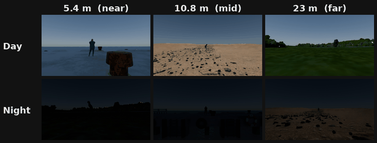

# SynDORBench: Benchmarking LVLM Perceptual Robustness Under Physically Constrained Visibility Conditions <!-- omit in toc -->
 


Figure 1. Conceptual overview of SynDORBench: The benchmark systematically varies physical visibility factors (lighting, scene type, camera azimuth/elevation, action pose) and DORI-calibrated viewing distance, evaluating models on two tasks: 1) binary human-presence classification and 2) action recognition (open-ended and MCQ).


# Table of Contents <!-- omit in toc -->

- [About](#about)
- [Installation](#installation)
- [Evaluation](#evaluation)
- [Licence and Usage](#licence-and-usage)
- [Citation](#citation)


# About

This repository contains the evaluation code for SynDORBench, a benchmark for studying LVLM perceptual robustness under DORI-calibrated, physically constrained camera imaging conditions. SynDORBench evaluates model performance across controlled variations in viewing distance, lighting, camera geometry, and action pose using rendered synthetic images.



Figure 2. Sample images from SynDORBench.


# Installation

Please refer to [INSTALL.md](INSTALL.md)

# Evaluation

Please refer to [EVAL.md](EVAL.md)

# Licence and Usage

This evaluation code is released under CC BY-NC-SA 4.0 for non-commercial academic research.

The code is intended to evaluate SynDORBench rendered images, annotations, and metadata. It does not include SMPL-X model files, AMASS motion files, BABEL source annotations, SMPLitex assets, or other upstream generation assets.

Users are responsible for complying with the original licences and terms of use of any third-party resources used with this code. Where upstream terms are more restrictive than the code-level licence, the upstream terms prevail.

# Citation

If you use SynDORBench, please cite SynDORBench:
```
@article{yee2026syndorbench,
  title={SynDORBench: Evaluating LVLM Perceptual Robustness Under Physically Constrained Visibility Conditions},
  author={Yee, Jeremy Stephen Gabriel and Wang, Zhengkui and Zhang, Zhiyuan and Anand, Avinash and Liu, Timothy and Chan, Benedict and Ng, Aik Beng and See, Simon},
  journal={arXiv preprint arXiv:2609.31823},
  year={2026}
}

```
